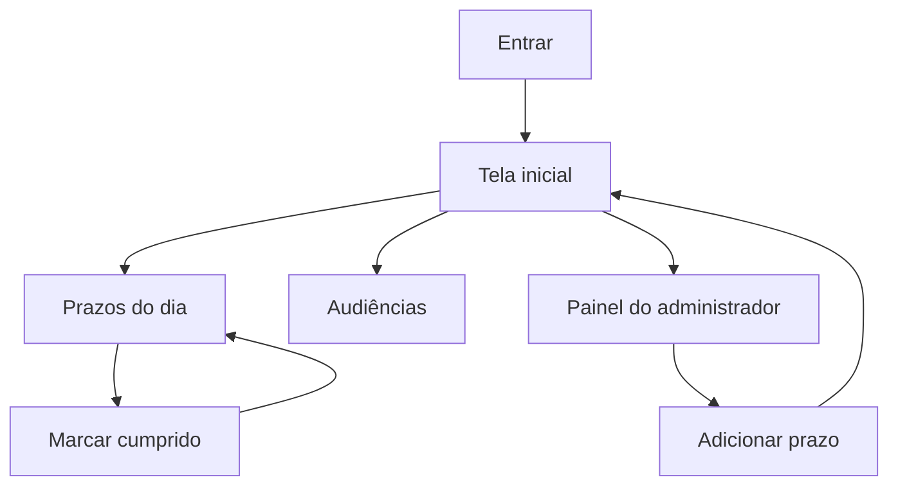

# Fluxo do App — Agenda Vignini

> Como o usuário se move pelo produto.
> Fonte: [x] Entrevista com usuário  [x] Leitura de código existente
> Depende de: [PRD](PRD.md)

**Data**: 2026-10-13

## 1. Perfis de usuário

| Perfil | Descrição | Permissões principais |
|---|---|---|
| usuario | Equipe do escritório | Ver prazos, audiências e agenda; cumprir prazo; alterar os próprios dados |
| admin | Quem cadastra e fecha o controle | Tudo do usuário, mais criar/editar/excluir prazo e audiência, desfazer cumprimento, usuários e relatório |

**Fonte: leitura do código** (`$_SESSION['grupo']` em `leftbar.php` e `acoes-prazos.php`).

## 2. Jornadas principais

### Jornada: começar o dia

Perfil: usuario ou admin

1. Entra com login e senha.
2. Vê prazos de hoje, prazos da semana e audiências da semana.
3. Abre o dia no calendário ou no contador.
4. Lê o ato e o texto. Marca cumprido, se for o caso.

Telas envolvidas: Entrar, Tela inicial, Prazos do dia.
Fluxo de erro: login inválido permanece na tela de entrar, sem detalhar qual campo falhou.

### Jornada: cadastrar prazo

Perfil: admin

1. Abre Adicionar prazo.
2. Informa área (administrativo, cível, trabalhista), data, título do ato, observação, texto e ao menos um responsável.
3. Salva. O prazo passa a aparecer no dia e no resumo da pessoa.

Telas envolvidas: Adicionar prazo.
Fluxo de erro: sem responsável ou sem data, o formulário não salva e aponta o campo. No legado, a ausência de `advogados` gerava aviso e não gravava o vínculo. **Fonte: leitura do código.**

### Jornada: audiência da semana

Perfil: usuario

1. Abre Audiências a partir do contador ou do menu.
2. Vê processo, vara, local, partes, preposto e horário.

Telas envolvidas: Audiências.
Ponto de decisão: só admin cria ou edita.

### Jornada: achar telefone ou processo antigo

Perfil: usuario ou admin

1. Pesquisa no menu, ou abre Agenda, ou abre Outros anos.
2. O resultado lista o contato ou os prazos cujo texto contém o termo.

Telas envolvidas: Pesquisar, Agenda, Outros anos.

### Jornada: relatório

Perfil: admin

1. Escolhe advogado que entra no relatório e o intervalo.
2. Vê e imprime.

Telas envolvidas: Relatórios.
**Fonte: leitura de** `adm-form-relatorios.php`.

## 3. Diagrama

---

## Gaps & Recomendações

- [x] Gap: o e-mail diário depende de `prazosUsuarios`, quase vazio. **Fonte: leitura do dump.**
- Recomendação: o resumo só promete prazo novo, com responsável obrigatório.
- [x] Gap desta base: as rotas existem e o login ainda não bloqueia a navegação, para a revisão visual.
- Recomendação: na fase de paridade, sessão inválida volta para Entrar, como `verificarLogin()`.
